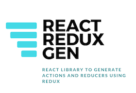

### NPM

[react-redux-gen on NPM](https://www.npmjs.com/package/react-redux-gen)

### Install

```bash
yarn add react-redux-gen
# or
npm install react-redux-gen
```

Peer dependency: `redux` (>= 4). Async REST/GraphQL thunks use `axios` (bundled dependency).

# react-redux-gen

Generate Redux **action names**, **plain action creators**, **async thunks**, and **reducers** from naming conventions.

v1 is written in **TypeScript**, supports **REST**, **GraphQL**, and **WebSocket** via a pluggable adapter layer, and uses **named** lifecycle access (`requested` / `success` / `error`) instead of array indices.

> New to Redux? Start with the [official Redux docs](https://redux.js.org/).

## Why?

As apps grow, action/reducer boilerplate repeats. If your API follows REST (or GraphQL / WS) conventions, you can generate the Redux surface once and stay consistent.

## Quick start

```ts
import { createClient, genPlainActions, genReducer } from 'react-redux-gen'

// 1) Choose a protocol
const client = createClient({
  protocol: 'REST',
  baseUrl: 'https://api.example.com/users',
  headers: { Authorization: `Bearer ${token}` },
})

// 2) Generate async thunks + reducer
const userAsync = client.genAsyncActions('user')
const userReducer = client.genReducer('user', {
  data: null,
  error: false,
  completed: true,
})

// 3) Dispatch
dispatch(userAsync.list())
dispatch(userAsync.create({ name: 'Ada' }))
dispatch(userAsync.fetch(1))
dispatch(userAsync.update(1, { name: 'Ada Lovelace' }))
dispatch(userAsync.delete(1))
```

### Named lifecycle (important)

```ts
const actions = genPlainActions('user', ['action'])

// Prefer named keys:
actions.action.requested()
actions.action.success(data)
actions.action.error(error)

// Action type strings:
const names = client.genActionNames('user')
names.create.requested // 'CREATE_USER_REQUESTED'
names.create.success   // 'CREATE_USER_SUCCESS'
names.create.error     // 'CREATE_USER_ERROR'
```

> **Migration from v0:** `actions.x[0|1|2]` → `actions.x.requested|success|error`.

---

## Core generators

These work with any protocol (they only care about naming):

```ts
import {
  genActionNames,
  genPlainActions,
  genAsyncActions,
  genReducer,
} from 'react-redux-gen'
```

### `genActionNames(entity, types?, states?)`

Returns named action **type strings**.

| Parameter | Type | Default |
|-----------|------|---------|
| `entity` | `string` | required |
| `types` | `string[]` | `['create','update','delete','list','fetch']` |
| `states` | `string[]` | `['REQUESTED','SUCCESS','ERROR']` |

```ts
genActionNames('user')
// {
//   create: { requested: 'CREATE_USER_REQUESTED', success: '...', error: '...' },
//   update: { ... },
//   ...
// }
```

### `genPlainActions(entity, types?, states?)`

Returns named **action creators**.

```ts
const actions = genPlainActions('user')

actions.create.requested()
// { type: 'CREATE_USER_REQUESTED', completed: false }

actions.create.success({ id: 1 })
// { type: 'CREATE_USER_SUCCESS', completed: true, error: false, data: { id: 1 } }

actions.create.error(err)
// { type: 'CREATE_USER_ERROR', completed: true, error: err }
```

### `genAsyncActions(entity, url, headers?, types?, states?)`

Convenience wrapper for **REST** (same as `createClient({ protocol: 'REST', baseUrl: url })`).

```ts
const userAsync = genAsyncActions('user', 'https://api.example.com/users', {
  Authorization: 'Bearer …',
})

dispatch(userAsync.create({ name: 'Ada' }))
```

### `genReducer(entity, initialState)`

Standard CRUD reducer for default types × default states.

```ts
const user = genReducer('user', { data: {}, error: false, completed: true })
```

---

## Protocol adapters

Initialize once with the protocol your project uses. Adapters share a common base class so more transports can be added later.

```ts
import { createClient } from 'react-redux-gen'

createClient({ protocol: 'REST', baseUrl: '…' })
createClient({ protocol: 'GRAPHQL', endpoint: '…' })
createClient({ protocol: 'WEBSOCKET', url: '…' })
```

Every adapter implements:

```ts
interface Adapter {
  readonly protocol: 'REST' | 'GRAPHQL' | 'WEBSOCKET'
  genActionNames(entity, types?, states?)
  genPlainActions(entity, types?, states?)
  genAsyncActions(entity, options?)
  genReducer(entity, initialState)
}
```

### REST

```ts
const rest = createClient({
  protocol: 'REST',
  baseUrl: 'https://api.example.com/users',
  headers: { 'Content-Type': 'application/json' },
})

const asyncActions = rest.genAsyncActions('user')
// optional resource URL override:
rest.genAsyncActions('user', 'https://api.example.com/v2/users')
```

| Op | HTTP | URL |
|----|------|-----|
| list | GET | `baseUrl` |
| fetch | GET | `baseUrl/:id` |
| create | POST | `baseUrl` |
| update | PUT | `baseUrl/:id` |
| delete | DELETE | `baseUrl/:id` |

### GraphQL

Generates standard **list** / **get** queries and **create** / **update** / **delete** mutations.

```ts
const gql = createClient({
  protocol: 'GRAPHQL',
  endpoint: 'https://api.example.com/graphql',
  selection: 'id name email',
})

const asyncActions = gql.genAsyncActions('user')

// Override documents when needed:
gql.genAsyncActions('user', {
  operations: {
    list: `query { users { id name } }`,
  },
})
```

### WebSocket

Sends JSON envelopes and waits for a correlated response (`requestId` / matching `type`).

```ts
const ws = createClient({
  protocol: 'WEBSOCKET',
  url: 'wss://api.example.com/ws',
  messageTypePrefix: 'app',
  // Node / tests: inject a socket factory
  createSocket: (url) => new WebSocket(url),
})

const asyncActions = ws.genAsyncActions('message')
dispatch(asyncActions.create({ text: 'hello' }))
```

Envelope:

```json
{ "type": "app.message.create", "payload": { "text": "hello" }, "requestId": "…" }
```

---

## Custom async actions

Use plain generators when the flow is not standard CRUD (login, multi-step, etc.):

```ts
import axios from 'axios'
import { genPlainActions, genActionNames } from 'react-redux-gen'

const loginActions = genPlainActions('user', ['logged', 'login', 'logout', 'register'])
const loginActionNames = genActionNames('user', ['logged', 'login', 'logout', 'register'])

const login = (user) => (dispatch) => {
  dispatch(loginActions.login.requested())
  return axios
    .post('/authorize/local', user)
    .then((res) => dispatch(loginActions.login.success(res.data)))
    .catch((err) => dispatch(loginActions.login.error(err)))
}
```

Hand-written reducer:

```ts
switch (action.type) {
  case loginActionNames.login.requested:
    return { ...state, completed: action.completed }
  case loginActionNames.login.success:
    return { ...state, completed: action.completed, data: action.data, error: false }
  case loginActionNames.login.error:
    return { ...state, completed: action.completed, error: action.error }
  default:
    return state
}
```

Full runnable demos: **[examples/](./examples)** (REST, GraphQL, WebSocket, custom auth).

---

## Project structure

```
src/
  types.ts                 # shared public types
  index.ts                 # public API
  constants/               # default CRUD types & states
  shared/                  # pure helpers (one function per file)
  actions/                 # genActionNames, genPlainActions, genAsyncActions
  reducers/                # genReducer
  adapters/
    types.ts
    base-adapter.ts        # abstract Adapter
    create-client.ts       # factory
    rest/
    graphql/
    websocket/
```

Design rules:

- **Types** live in `types.ts` (or adapter-local `types.ts`)
- **One function (or class) per file**
- **Shared pure logic** under `shared/`
- **Protocol code** isolated under `adapters/<name>/`

---

## Contribute

### Development setup

```bash
# Node 18+ recommended
npm install
npm test
npm run test:coverage   # threshold: 90%
npm run build
npm run typecheck
```

### Scripts

| Script | Description |
|--------|-------------|
| `npm test` | Jest unit tests |
| `npm run test:coverage` | Coverage report (fails under 90%) |
| `npm run build` | Emit CJS + ESM + `.d.ts` via tsup |
| `npm run dev` | Watch build |
| `npm run typecheck` | `tsc --noEmit` |

### Examples

```bash
npm run build
cd examples && npm install
npm run rest      # or graphql | websocket | custom | all
```

See [examples/README.md](./examples/README.md).

---

## Contribution guidelines: creating a new adapter

Adapters let the library support additional transports (gRPC-web, Firebase, tRPC, …) without mixing concerns.

### 1. Folder layout

```
src/adapters/myprotocol/
  types.ts              # protocol-specific options & message types
  myprotocol-adapter.ts # class extending BaseAdapter
  # one helper function per file, e.g.:
  build-request.ts
  create-myprotocol-thunk.ts
```

### 2. Extend `BaseAdapter`

```ts
// src/adapters/myprotocol/myprotocol-adapter.ts
import { BaseAdapter } from '../base-adapter'
import type { AsyncActionsMap } from '../../types'
import type { MyProtocolAdapterOptions } from './types'
import { createMyProtocolThunk } from './create-myprotocol-thunk'

export class MyProtocolAdapter extends BaseAdapter {
  readonly protocol = 'MYPROTOCOL' as const
  // store options…

  constructor(options: MyProtocolAdapterOptions) {
    super(options)
    // …
  }

  genAsyncActions(entity: string, options?: unknown): AsyncActionsMap {
    const plain = this.genPlainActions(entity)
    const actions: AsyncActionsMap = {}

    Object.keys(plain).forEach((key) => {
      actions[key] = createMyProtocolThunk(
        key,
        entity,
        /* transport deps */,
        plain[key]
      )
    })

    return actions
  }
}
```

`BaseAdapter` already implements `genActionNames`, `genPlainActions`, and `genReducer`. You only implement **async I/O**.

### 3. Thunk contract

Each async action must:

1. `dispatch(plain.requested())`
2. Perform the transport call
3. `dispatch(plain.success(data))` or `dispatch(plain.error(error))`
4. Return a `Promise` so callers can `await dispatch(...)`

Use helpers from `src/shared/` for action objects when useful; reuse `createStateActionCreator` / named maps rather than inventing parallel shapes.

### 4. Register the protocol

1. Extend `Protocol` in `src/types.ts` (or keep protocol as a string on the class only).
2. Add options to the `CreateClientOptions` union in `src/adapters/types.ts`.
3. Handle the case in `src/adapters/create-client.ts`.
4. Export the adapter + types from `src/index.ts`.

### 5. Types

- Put **public** types in `src/types.ts` or export adapter `types.ts` from the package entry.
- Keep **internal** request/response shapes in the adapter folder’s `types.ts`.
- Prefer explicit interfaces over `any`.

### 6. Tests (required)

Add `tests/myprotocol-adapter.test.ts` covering:

- Success path for each operation you support  
- Error path  
- Edge cases (timeouts, malformed payloads, missing config)  
- `createClient({ protocol: 'MYPROTOCOL', … })` wiring  

Keep global coverage **≥ 90%** (`npm run test:coverage`).

### 7. Example + docs

1. Add `examples/src/myprotocol/` with a runnable offline demo.  
2. Document it in `examples/README.md`.  
3. Add a short section to this README under **Protocol adapters**.  
4. List any new peer dependencies in `package.json` and this install section.

### 8. Checklist

- [ ] `src/adapters/<name>/` with one function/class per file  
- [ ] Extends `BaseAdapter`, implements `genAsyncActions`  
- [ ] Registered in `createClient`  
- [ ] Exported from `src/index.ts`  
- [ ] Unit tests + coverage ≥ 90%  
- [ ] Example project + README notes  
- [ ] No protocol-specific logic leaked into `shared/` or other adapters  

### Architecture sketch

```
                 createClient(options)
                         │
           ┌─────────────┼─────────────┐
           ▼             ▼             ▼
      RestAdapter  GraphQLAdapter  WebSocketAdapter
           │             │             │
           └─────────────┴─────────────┘
                         │
                   BaseAdapter
              genActionNames / genPlainActions / genReducer
                         │
              shared helpers + actions/ + reducers/
```

---

## Where it is used

### Ahorta — https://ahorta.io

Real-world actions/reducers: [ahorta-client](https://github.com/worknenjoy/ahorta-client/tree/master/src)

---

## License

MIT — see [LICENSE](./LICENSE)

Maintained by [Alexandre Magno](https://alexandremagno.net)
